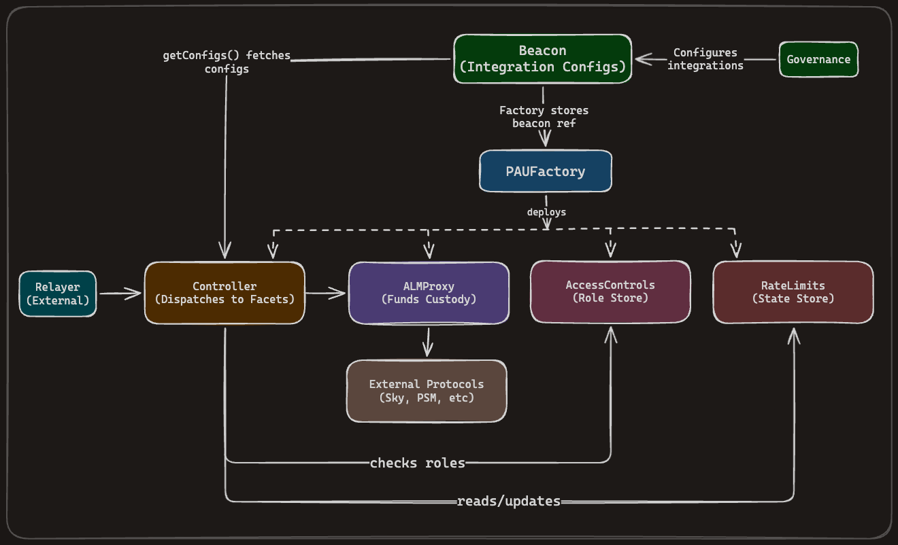

# Parallelized Allocation Unit (PAU)


[![Foundry][foundry-badge]][foundry]
[](https://github.com/marsfoundation/spark-alm-controller/blob/master/LICENSE)

[foundry]: https://getfoundry.sh/
[foundry-badge]: https://img.shields.io/badge/Built%20with-Foundry-FFDB1C.svg

## Overview

This repository contains the onchain components of the PAU system. The system enables controlled interaction with various DeFi protocols while enforcing rate limits and maintaining custody of funds through the ALMProxy.

### Core Contracts

| Contract         | Description                                                                           |
| ---------------- | ------------------------------------------------------------------------------------- |
| `ALMProxy`       | Proxy contract that holds custody of all funds and routes calls to external contracts |
| `Beacon`         | Single source of truth for integration configs                                        |
| `Controller`     | Unified controller with dispatch-based routing to specialized facets                  |
| `RateLimits`     | Enforces and manages rate limits on controller operations                             |
| `AccessControls` | Role-based access control for the system                                              |
| `OTCBuffer`      | Buffer contract for offchain OTC swap operations                                      |
| `PAUFactory`     | Factory contract that can deploy each component of the PAU system                     |

## Documentation

| Document                                                       | Description                                                 |
| -------------------------------------------------------------- | ----------------------------------------------------------- |
| [Architecture](./docs/ARCHITECTURE.md)                         | System architecture, contract interactions, and permissions |
| [Rate Limits](./docs/RATE_LIMITS.md)                           | Rate limit design, calculations, and configuration          |
| [Liquidity Operations](./docs/LIQUIDITY_OPERATIONS.md)         | Curve, Uniswap V3, Uniswap V4, OTC, and PSM integrations    |
| [weETH Integration](./docs/WEETH_INTEGRATION.md)               | EtherFi weETH module architecture and withdrawal flow       |
| [Threat Model](./docs/THREAT_MODEL.md)                         | Attack vectors, trust assumptions, and security invariants  |
| [Security](./docs/SECURITY.md)                                 | Protocol-specific considerations and audit information      |
| [Operational Requirements](./docs/OPERATIONAL_REQUIREMENTS.md) | Seeding, configuration, and onboarding checklists           |
| [Development](./docs/DEVELOPMENT.md)                           | Testing, deployment, and upgrade procedures                 |
| [Code Notes](./docs/CODE_NOTES.md)                             | Implementation details and design decisions                 |
| [Beacon](./docs/BEACON.md)                                     | Beacon integration configs, lifecycle, and versioning       |
| [UniV3/V4 Comparison](./docs/UNIV3_UNIV4_COMPARISON.md)        | Functional differences between UniswapV3 and V4 facets      |

## Quick Start

### Testing

```bash
forge test
```

See [Development Guide](./docs/DEVELOPMENT.md) for detailed instructions.

## Architecture Overview

The Beacon holds all integration configurations (facet addresses and selector wiring). The PAUFactory can deploy individual PAU system components (`ALMProxy`, `ALMProxyFreezable`, `RateLimits`, `AccessControls`, and `Controller`) with expected bytecode. The Controller is the entry point for all allocator calls. It syncs configs from the Beacon and dispatches to the appropriate facet, which checks rate limits and executes logic, performing calls to the ALMProxy atomically.



See [Architecture Documentation](./docs/ARCHITECTURE.md) for detailed diagrams and explanations.

## Max Slippages

Max slippage values throughout PAU integrations are defined as how close the resulting value should be to the expected or minimum value, **not** as how much deviation is allowed. This is an inverse way of denoting max slippages compared to common DeFi nomenclature.

### How It Works

In common DeFi terminology, a 0.1% max slippage typically means the resulting value can be 0.1% away from the expected or spot rate/value. However, throughout this codebase, such an expectation would be denoted as a max slippage of 99.9% (or 0.999e18 when scaled).

### Historical Context

The reason for this inverse notation is to allow a max slippage of 0 (the unset default value for any storage slot) to imply that the integration is disabled, instead of 0 implying "no slippage allowed". This design choice means that:

- A value of 0 indicates the integration is disabled
- Non-zero values represent the minimum acceptable ratio of actual result to expected result

### Value Scaling

All max slippage values are scaled to 1e18, meaning:

- `0.999e18` represents a "max slippage" of 99.9%, which means the resulting price, rate, or value must be **at least** 99.9% of the expected price, rate, or value
- `0.995e18` represents 99.5%, meaning the result must be at least 99.5% of the expected value
- `1e18` represents 100%, meaning no slippage is allowed (result must equal expected value)

### UniswapV4 Integration

Particularly for the UniswapV4 integration, since the pools being interacted with are assumed to pair 1:1 stablecoins (i.e., USDT and USDC), the max slippage defines how close to a 1.0 price the swap is allowed to be. For example:

- A max slippage of `0.999e18` means the swap out value must be at least $0.999 for each $1.00 of input value.
- A max slippage of `0.995e18` means the swap out value must be at least $0.995 for each $1.00 of input value.

## Security

### Key Trust Assumptions

- **`DEFAULT_ADMIN_ROLE`**: Fully trusted, run by governance
- **`ALLOCATOR_ROLE`**: Assumed compromisable - logic prevents unauthorized value movement
  See [Security Documentation](./docs/SECURITY.md) for complete trust assumptions and mitigations.

### Audits

Audit reports are hosted on the auditors' public portfolio pages:

Diamond PAU was forked from the Spark ALM Controller; the v1.0.0 to v1.10.0 reports below were performed on the Spark ALM Controller codebase.

| Auditor | Report | Version | Date |
| --- | --- | --- | --- |
| ChainSecurity | [Sky Diamond PAU v1.15](https://www.chainsecurity.com/security-audit/sky-diamond-pau-v1-15/) | - | 2026-11-02 |
| Cantina | [Sky: Diamond Pau v1.15.0](https://cantina.xyz/portfolio/c8a13c2b-60ef-43c4-ad38-9584c03aa15c) | - | 2026-10-06 |
| ChainSecurity | [Sky Diamond PAU v1.14](https://www.chainsecurity.com/security-audit/sky-diamond-pau-v1-14/) | v1.14.0 | 2026-07-06 |
| Cantina | [Sky: PAU NFAT Facet](https://cantina.xyz/portfolio/2db00e28-838f-4769-bc9f-8b0624f172d2) | v1.14.0 | 2026-06-25 |
| ChainSecurity | [Sky Diamond PAU v1.13](https://www.chainsecurity.com/security-audit/diamond-pau-v1-13/) | v1.13.0 | 2026-06-04 |
| ChainSecurity | [Diamond PAU v1.12](https://www.chainsecurity.com/security-audit/diamond-pau-v1-12/) | v1.12.0 | 2026-06-03 |
| Cantina | [Sky: PAU Factory Update](https://cantina.xyz/portfolio/bf7950aa-a53b-4688-b281-e25c2d6e7fef) | v1.13.0 | 2026-05-29 |
| Cantina | [Sky: Diamond Pau](https://cantina.xyz/portfolio/d1185899-3e3b-4cbc-b596-60c00ce61d07) | v1.12.0 | 2026-04-26 |
| ChainSecurity | [Sky Diamond PAU](https://www.chainsecurity.com/security-audit/sky-diamond-pau/) | v1.11.0 | 2026-03-17 |
| Cantina | [Sky: Diamond PAU v1.11.0](https://cantina.xyz/portfolio/15cf9a53-3671-4b68-88ee-13570a5ebd03) | v1.11.0 | 2026-03-10 |
| ChainSecurity | [Spark ALM Controller Diff Audit](https://www.chainsecurity.com/security-audit/spark-alm-controller-diff-audit/) | v1.10.0 | 2026-02-17 |
| Cantina | [Sky: Spark ALM Controller](https://cantina.xyz/portfolio/9a0dd836-1a9d-4e1b-98af-9d6238185e02) | v1.10.0 | 2026-02-09 |
| Cantina | [Sky: Spark ALM Controller v1.8](https://cantina.xyz/portfolio/f5d91713-c9bd-4ed3-966e-f933d4c2f70d) | v1.8.0 | 2025-10-22 |
| ChainSecurity | [Spark ALM Controller](https://www.chainsecurity.com/security-audit/spark-alm-controller/) | v1.0.0, v1.1.0, v1.3.0, v1.4.0, v1.5.0, v1.6.0, v1.7.0 | 2025-09-11 |
| Cantina | [Sky Spark ALM Controller](https://cantina.xyz/portfolio/288f500d-3cd1-43af-9690-7690273f3e80) | v1.7.0 | 2025-09-01 |
| Cantina | [Spark ALM Controller](https://cantina.xyz/portfolio/95632465-f6a2-43c2-8729-d26a718e6b9a) | v1.6.0 | 2025-08-08 |
| Cantina | [spark-alm-controller v1.5.0-beta.0](https://cantina.xyz/portfolio/af3b40b6-840a-45ef-93dd-b3f0e0ec2dac) | v1.5.0 | 2025-07-07 |
| Cantina | [Spark ALM Curve Controller Audit for MakerDAO](https://cantina.xyz/portfolio/c5408301-e8d5-4d84-b758-ac8d1f4d987f) | v1.4.0 | 2025-03-21 |
| Cantina | [MakerDAO Spark ALM Init Script Audit](https://cantina.xyz/portfolio/ba3e40ff-baf9-4def-8ae0-21f4a9473184) | v1.0.0 | 2024-10-18 |
| Cantina | [Spark ALM CCTP & Swap Logic Audit](https://cantina.xyz/portfolio/6e9c7968-9565-4b05-a8f2-f41ddc64ec27) | v1.0.0 | 2024-09-19 |

ChainSecurity reports are cumulative: each portfolio page hosts the latest version of the report, which covers all previously reviewed versions.

#### Other reports

The following reports are not available on an auditor portfolio page and are kept in this repository:

- [Cantina v1.1.0](./audits/v110-cantina-audit.pdf)
- [Unvariant v1.11.0](./audits/v1110-unvariant-audit.pdf)
- [Certora v1.12.0](./audits/v1120-certora-audit.pdf)
- [Octane v1.12.0](./audits/v1120-octane-audit.pdf)
- [Unvariant v1.12.0](./audits/v1120-unvariant_audit.pdf)
- [Cantina v1.3.0](./audits/v130-cantina-audit.pdf)
- [Certora v1.8.0](./audits/v180-certora-audit.pdf)
- [Cantina v1.9.0](./audits/v190-cantina-audit.pdf)
- [Certora v1.9.0](./audits/v190-certora-audit.pdf)

---

<p align="center">
  
</p>
